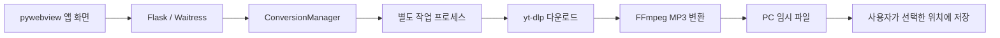

# Sound Pocket

YouTube 영상 주소를 입력해 **내 PC에 MP3를 저장하는 Windows 앱**입니다. 각 사용자의 PC에서 다운로드와 변환을 처리하므로 운영자의 PC나 별도 변환 서버가 필요하지 않습니다.

- **Windows 10/11 64비트**용 실행 패키지
- 앱 회원가입·로그인 없이 사용
- Python, Node.js, FFmpeg가 포함된 ZIP 배포
- 외부 변환 서버로 영상·MP3를 전송하지 않음

## 빠른 시작

1. 배포받은 `SoundPocket-Windows-x64.zip`을 **전체 압축 해제**합니다.
2. `SoundPocket` 폴더의 **`SoundPocket.exe`**를 실행합니다.
3. YouTube 영상 주소를 붙여 넣고 MP3 음질을 선택합니다.
4. **MP3로 변환하기**를 누릅니다.
5. 완료되면 **MP3 다운로드**를 눌러 저장 위치를 선택합니다.

```text
SoundPocket/
├── SoundPocket.exe
├── _internal/       # 앱 실행에 필요한 구성요소
├── licenses/        # 포함된 구성요소의 라이선스
└── 사용방법.txt
```

`SoundPocket.exe`만 옮기면 실행되지 않습니다. 다른 사람에게 공유할 때도 **ZIP 전체**를 전달하세요. GitHub의 **Code → Download ZIP**은 소스 코드이며, 실행 앱 패키지와 다릅니다. 실행 ZIP은 소스 저장소에 포함하지 않습니다.

자세한 사용법: [DESKTOP_README.txt](DESKTOP_README.txt)

## 실행 환경

| 항목 | 조건 |
| --- | --- |
| 운영체제 | Windows 10/11 x64 |
| 인터넷 | YouTube 다운로드에 필요 |
| 화면 실행 | Microsoft Edge WebView2 Runtime 필요 |
| 별도 설치가 필요 없는 도구 | Python, Node.js, FFmpeg |
| 비용 | 앱 구독·서버 비용 없음. 각 PC의 인터넷·전력을 사용 |

WebView2가 없는 PC는 [Microsoft 공식 페이지](https://developer.microsoft.com/microsoft-edge/webview2/)에서 설치할 수 있습니다. macOS·Linux 실행 파일은 현재 제공하지 않습니다.

실행 파일은 코드 서명되지 않았습니다. Windows에서 게시자 확인 경고가 표시될 수 있으므로 배포받은 파일의 출처를 확인하세요.

## 기능과 제한

| 항목 | 현재 지원 범위 |
| --- | --- |
| 입력 주소 | 일반 YouTube, youtu.be, Shorts, YouTube Music의 개별 영상 |
| 출력 | MP3, 128 또는 192kbps |
| 영상 길이 | 최대 30분 |
| 동시 작업 | 앱 인스턴스당 한 개 |
| 진행 상태 | 영상 확인 → 오디오 다운로드 → MP3 변환 |
| 작업 취소 | 진행 중 취소 가능. 앱 종료 시 진행 중 작업도 종료 |
| 임시 파일 | 완료 후 15분 보관. 새 작업 시작 시 오래된 완료 작업이 먼저 정리될 수 있음 |
| 처리 한도 | 원본 최대 160MiB, 작업 폴더 약 220MiB, 작업 최대 15분 |

로그인이 필요한 영상, 비공개 영상, 진행 중인 실시간 방송, 재생목록 전체 변환은 지원하지 않습니다. 결과 음질은 원본 음질에 영향을 받습니다.

직접 제작했거나 다운로드·변환 권한이 있는 영상에 사용하세요. YouTube의 접근 제한이나 서비스 변경으로 변환이 실패할 수 있으며, PC 앱이 차단 해제를 보장하지는 않습니다. 로그인 쿠키 수집이나 유료 프록시 기능은 없습니다.

## 파일 저장과 데이터 처리

- **저장한 MP3:** 사용자가 선택한 폴더에 남으며 앱이 자동 삭제하지 않습니다.
- **임시 MP3:** 앱이 실행되는 동안 15분 보관하며 정상 종료 시 정리합니다. 앱을 닫기 전에 저장하세요.
- **앱 데이터:** 기본 위치는 `%LOCALAPPDATA%\SoundPocket`입니다. 실행 로그와 인스턴스별 임시 작업 폴더가 생성됩니다.
- **강제 종료:** 임시 파일이 남을 수 있습니다. 수동 정리가 필요하면 모든 Sound Pocket 창을 닫은 뒤 해당 데이터 폴더의 `session-*` 폴더를 확인하세요.

화면은 pywebview로 표시하고, 내부 Flask/Waitress 서비스는 `127.0.0.1`의 임의 포트에만 연결합니다. 외부에 공개되는 공유 URL은 없습니다. 앱 종료 후에는 내부 주소도 사용할 수 없습니다.

## 구현 구조



| 구성 | 구현 방식 |
| --- | --- |
| 화면 | HTML·CSS·JavaScript를 pywebview와 Windows WebView2로 표시 |
| 내부 API | Flask/Waitress를 `127.0.0.1`의 임의 포트에서 실행 |
| 작업 관리 | 메모리에서 진행 상태 관리, 앱 인스턴스당 한 작업으로 제한 |
| 다운로드·변환 | 별도 프로세스에서 yt-dlp와 FFmpeg 실행. 이벤트를 통해 진행 상태 전달 |
| 취소·종료 | 실행 중 작업 프로세스 트리를 종료하고 임시 작업 정리 |
| 요청 보호 | 로컬 Host 검사, 세션별 CSRF 토큰, YouTube 주소 검증 |
| 배포 | PyInstaller로 실행 파일·의존성·Node.js·FFmpeg를 묶어 ZIP 생성 |

각 PC에서 화면과 작업 처리가 함께 실행됩니다. 중앙 변환 서버, 사용자 계정 데이터베이스, 자동 업데이트 서비스는 사용하지 않습니다.

## 개발 환경에서 실행

빌드·개발 PC에는 **Python 3.12 x64와 Node.js**가 필요합니다. 저장소 루트에서 다음 명령을 실행하세요.

```powershell
python -m venv .venv
.\.venv\Scripts\python.exe -m pip install -r requirements-desktop.lock
.\.venv\Scripts\python.exe desktop.py
```

개발용 브라우저 미리보기도 실행할 수 있습니다.

```powershell
.\.venv\Scripts\python.exe start_local.py
```

이 경우에만 [http://127.0.0.1:8765](http://127.0.0.1:8765)를 사용합니다. 개발용 `.local.json`에는 세션 서명 키가 들어 있으므로 공유하거나 커밋하지 마세요.

## Windows 실행 패키지 만들기

개발 환경을 설치한 뒤, 실행 중인 배포 앱을 닫고 다음 명령을 실행합니다.

```powershell
.\.venv\Scripts\python.exe build_desktop.py
```

| 결과물 | 위치 — 저장소 루트 기준 |
| --- | --- |
| 실행 앱 폴더 | `dist/SoundPocket/` |
| 공유용 ZIP | `../output/SoundPocket-Windows-x64.zip` |

PyInstaller가 Python과 앱 의존성을 묶고, 빌드 PC의 Node.js 실행 파일과 imageio-ffmpeg의 FFmpeg를 포함합니다. Node.js 버전을 변경한다면 함께 배포하는 `NODE_LICENSE.txt`도 해당 버전에 맞게 확인하세요. 구성요소 고지는 [THIRD_PARTY_NOTICES.md](THIRD_PARTY_NOTICES.md)를 참고하세요.

## 검증

```powershell
.\.venv\Scripts\python.exe -m unittest discover -s tests -v
node --check static/app.js
```

완성된 실행 파일 자체를 검증하려면, 저장소 루트에서 다음 명령을 실행합니다.

```powershell
New-Item -ItemType Directory -Force artifacts | Out-Null
Start-Process -FilePath '.\dist\SoundPocket\SoundPocket.exe' -ArgumentList '--data-dir artifacts\smoke-data --smoke-test artifacts\desktop-smoke.json' -Wait
Get-Content artifacts\desktop-smoke.json
```

기본 실행 파일 검증은 로컬 HTTP 응답, Host 검사, CSRF 방어, 포함된 Node.js 실행, 실제 FFmpeg 인코딩, 임시 작업 정리를 확인합니다. YouTube 다운로드까지 검증하려면 `-ArgumentList` 문자열 끝에 `--test-video <권한이 있는 공개 영상 URL>`을 추가하세요.

## 문제 해결

| 증상 | 확인할 내용 |
| --- | --- |
| 앱이 열리지 않음 | ZIP 전체 압축 해제 여부, `_internal` 폴더, WebView2 설치 여부 |
| 연결 오류 | 앱을 다시 실행. 일반 PC 앱에 고정된 `8765` 주소를 사용하지 않음 |
| 봇 확인·HTTP 403 | YouTube가 해당 PC의 요청을 거부한 상태. 반복 요청을 멈추고 브라우저에서 영상 접근 상태 확인 |
| HTTP 429 | 요청 횟수 제한. 연속 변환을 멈추고 나중에 재시도 |
| 검증 토큰 관련 오류 | 다운로드 도구와 YouTube 검증 설정 점검 필요 |
| 다운로드 버튼 만료 | 임시 파일 보관 시간 경과 또는 앱 종료. 다시 변환 필요 |

YouTube 변경에 대응해 다운로드 도구를 업데이트할 때는 `requirements-desktop.lock`을 함께 갱신하고, 테스트와 실행 파일 검증 후 **ZIP을 다시 빌드·배포**하세요. 소스만 수정해도 이미 전달한 앱이 자동 업데이트되지는 않습니다.

## 주요 파일

| 파일 | 역할 |
| --- | --- |
| `desktop.py` | PC 앱 창, 로컬 서비스, 실행 도구 설정 및 종료 처리 |
| `app.py` | 작업 관리, 진행 상태, 취소, MP3 다운로드 API |
| `worker.py` | yt-dlp 다운로드와 FFmpeg 변환 |
| `static/` | 공통 변환 화면과 스타일 |
| `build_desktop.py` | Windows 실행 폴더 및 공유 ZIP 생성 |
| `desktop_smoke.py` | 패키지 안에서 실행하는 검증 |
| `requirements-desktop.lock` | PC 앱·빌드 환경 의존성 버전 |
| `tests/` | API·작업 관리·오디오·오류 처리 테스트 |

## 관련 문서

- [사용 안내](DESKTOP_README.txt)
- [개발·운영 이력](HISTORY.md)
- [외부 구성요소 및 라이선스](THIRD_PARTY_NOTICES.md)
